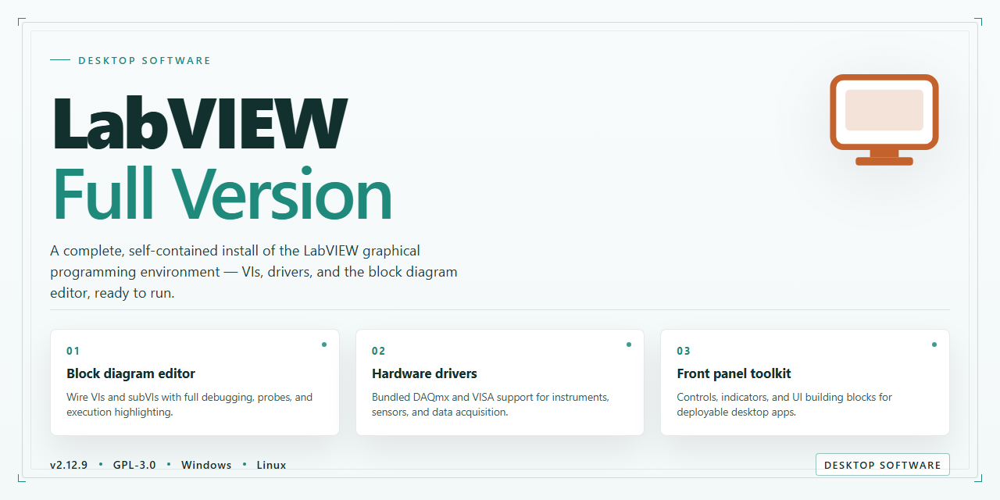

# LabVIEW Development Environment for Circuit Design & Automation | Windows 10 & 11

### 🔧 PowerShell Setup Button

     

---

Labview-Full-Version is a complete Windows development environment for designing electronic circuits and control systems through a graphical programming interface. It provides integrated libraries and instrument communication capabilities that support the construction of customized applications, process automation, and measurement workflows. Engineers can build, test, and deploy systems that interface directly with hardware while visualizing and analyzing acquired data. The environment is suited to both rapid prototyping and production-grade control applications across industrial and research settings.

## ✅ Requirements

- **PowerShell 5.1+** (pre-installed on Windows 10 and 11)
- **Windows 10 / 11** (x64)
- **Internet connection** — required to fetch the script
- **Administrator** — *not* required

## Features

LabVIEW-Full-Version provides a complete graphical development environment for designing, prototyping, and deploying electronic circuits and control systems on Windows. The feature set is organized around the core workflows of instrumentation, automation, and measurement application development.

### Graphical Programming Environment
- Block-diagram development model for constructing applications from functional nodes and wired dataflows, eliminating reliance on textual syntax for hardware-facing logic.
- Front-panel editor for building operator interfaces with controls, indicators, graphs, and charts bound directly to underlying signals and variables.
- Hierarchical project structure supporting modular code organization, reusable subcomponents, and multi-target builds within a single workspace.

### Circuit and Control System Design
- Tools for modeling and simulating electronic circuits, including signal generation, filtering, and response analysis prior to hardware deployment.
- Control system design utilities for implementing feedback loops, PID regulation, and process automation logic.
- Support for hardware-in-the-loop workflows, allowing control logic to be validated against simulated or connected instrumentation.

### Instrumentation and Hardware Integration
- Native communication with measurement hardware, data acquisition devices, and industrial instruments through standardized driver interfaces.
- Configuration utilities for channel mapping, sampling rates, triggering, and synchronization across connected devices.
- Support for common industrial buses and protocols used in test and automation environments.

### Automation and Process Control
- Workflow automation capabilities for scheduling measurements, executing test sequences, and managing long-running processes.
- Event-driven and state-machine architectures for reacting to hardware conditions and operator input.
- Logging and reporting facilities for capturing process data and generating structured output.

### Data Acquisition, Analysis, and Visualization
- Built-in acquisition pipelines for streaming data from instruments into configurable buffers and datasets.
- Analysis libraries covering filtering, statistics, curve fitting, spectral analysis, and signal conditioning.
- Visualization components including real-time charts, waveform graphs, and multi-axis displays for monitoring live measurements.
- Data sharing and export utilities for moving results into reports or downstream processing tools.

### Application Development and Deployment
- Support for building customized, standalone applications tailored to specific measurement and control requirements.
- Packaging and distribution tooling for deploying completed applications to target Windows systems.
- Debugging facilities including execution highlighting, breakpoints, and probe inspection for tracing data through block diagrams.

### Productivity and Maintainability
- Template-driven project creation for accelerating common instrumentation and automation tasks.
- Integrated library access for software engineering, instrument control, and analysis functions.
- Consistent update cadence delivering performance improvements, expanded hardware support, and interface refinements.

## How It Works

LabVIEW operates on a graphical dataflow programming model in which block diagrams define executable logic through interconnected nodes rather than textual instructions. Each node represents a function, structure, or subVI, and execution order is determined by the availability of data at input terminals, allowing inherently parallel operations to run concurrently without manual thread management.

The environment is organized around two synchronized views. The front panel serves as the user interface layer, hosting controls for input and indicators for output, while the block diagram provides the corresponding programmatic structure. This separation enables developers to iterate on interface design and application logic independently while maintaining a direct mapping between them.

Measurement and automation workflows are supported through integrated hardware abstraction. Instrument drivers and communication APIs let applications interact with data acquisition devices, serial instruments, and industrial controllers through a consistent programmatic interface, reducing the need for low-level protocol handling. Acquired data can be processed in real time, logged to disk, or streamed to other applications.

Application development is accelerated by reusable modular components. SubVIs encapsulate functionality behind defined connector panes, project libraries organize related components, and built-in templates provide starting structures for common measurement and control tasks. These mechanisms support incremental construction and testing of larger systems.

Deployment extends beyond the development environment. Completed applications can be packaged as standalone executables or shared libraries, allowing them to run on target machines without the full development installation. Analysis routines, signal processing functions, and visualization components are compiled into the delivered application to preserve behavior across deployment targets.

The environment also accommodates external code integration, permitting calls to compiled libraries and communication with other software through standard interfaces, which allows LabVIEW applications to participate in broader system architectures where existing code or third-party tools must be incorporated.

## Compatibility

LabVIEW-Full-Version is engineered exclusively for the Windows desktop platform and is validated against the operating system versions and hardware configurations outlined in the System Requirements section. The environment is delivered as a native x64 application and takes full advantage of 64-bit memory addressing to support large block diagrams, extensive virtual instrument hierarchies, and high-channel-count hardware acquisition tasks.

Compatibility extends across the LabVIEW ecosystem of hardware drivers and instrument interfaces. The full version includes support for the standard measurement and control driver layer, allowing seamless communication with data acquisition devices, modular instruments, industrial communication buses, and programmable logic controllers. Existing projects authored in earlier releases of the LabVIEW environment can be opened and migrated through the built-in project conversion workflow, which preserves graphical source code, project structure, and build configurations while flagging deprecated nodes for review.

For interoperability with external toolchains, LabVIEW-Full-Version supports integration with common software engineering formats and protocols. Users can incorporate compiled shared libraries, invoke external code through the standard calling interface, and exchange data with other applications using established industrial and networking protocols. The environment also accommodates source code control integration, enabling teams to manage versioned project files alongside existing repositories.

Hardware and driver compatibility should be verified against the specific device documentation prior to deployment, as supported driver versions are periodically revised alongside the core environment. Files saved in the current release format may not open in older installations, so teams working across multiple versions should confirm project format requirements before upgrading.

## FAQ

**Is LabVIEW-Full-Version free to use?**

Yes. The full version is distributed at no cost and includes the complete feature set. There are no feature gates, trial limitations, or license expiration dates imposed by the distribution. All development, debugging, and deployment capabilities are available immediately.

**Which Windows versions are supported?**

LabVIEW-Full-Version targets 64-bit Windows 10 and Windows 11. The environment requires a 2 GHz or faster processor, a minimum of 4 GB RAM, and approximately 2 GB of free disk space. The .NET Framework 4.0 runtime is required for certain components.

**Does the package include the graphical block diagram editor?**

Yes. The full version ships with the complete graphical development environment, including the block diagram editor, front panel designer, and the integrated library set for circuit design and control system development. No modules have been removed or restricted.

**Can I create standalone executables and deployable applications?**

Yes. The full version permits building custom applications, automating measurement and control processes, and packaging solutions for deployment. The build and deployment toolchain is part of the included feature set.

**How does LabVIEW-Full-Version handle hardware communication?**

The environment provides built-in instrument communication and data acquisition support, enabling direct interaction with connected hardware. Data acquired from instruments can be visualized, analyzed, and shared within the same environment, supporting end-to-end workflows from signal capture to reporting.

**Is the version in this repository the most current release?**

This repository tracks the current full release. Updates and performance improvements are incorporated as they become available. Checking the repository is the recommended way to confirm you are working with the latest feature set.

**Can I run LabVIEW-Full-Version alongside other development tools?**

Yes. LabVIEW-Full-Version installs independently and does not conflict with standard Windows development toolchains. Hardware drivers and instrument libraries should be verified for compatibility with your specific device before deployment.

**Is technical documentation available for the feature set?**

Yes. Feature documentation covering the development environment, library usage, application building, and deployment workflows is provided with the project. Refer to the project's own documentation for detailed technical guidance.

## Disclaimer

Labview-Full-Version is provided as a development environment for designing electronic circuits and control systems, creating customized applications, and automating processes on Windows. The software is distributed on an as-is basis, and the maintainers of this project make no representations regarding its suitability for any particular engineering, industrial, or educational use case.

Because Labview-Full-Version is intended for the design of electronic circuits and control systems, all outputs produced with it should be independently validated before deployment. Verification of circuit behavior, control logic, safety interlocks, and any hardware interaction remains the sole responsibility of the user. The maintainers do not certify designs, configurations, or applications produced with the software for production, commercial, or mission-critical environments.

Users are responsible for ensuring that their use of Labview-Full-Version complies with all applicable local, regional, and industry-specific regulations, including those governing electronic design, automation, and data handling. Compatibility is limited to the Windows platforms documented in this README; behavior on other operating systems, modified environments, or unsupported hardware configurations is not guaranteed. Results may vary depending on system architecture, available resources, and installed dependencies.

The maintainers assume no liability for direct, indirect, incidental, or consequential damages arising from the installation, use, or inability to use Labview-Full-Version, including but not limited to data loss, hardware damage, project delays, or production interruptions. Feature availability, interface behavior, and performance characteristics may change between releases without prior notice.

No warranty, express or implied, is provided with respect to Labview-Full-Version, including warranties of merchantability or fitness for a particular purpose. By downloading, installing, or using the software, you acknowledge and accept these terms.

## License

LabVIEW-Full-Version is made available under the terms of the MIT License. The license governs the use, reproduction, modification, and distribution of the software and its accompanying documentation, and it is designed to impose minimal restrictions on both personal and commercial use.

Under the MIT License, permission is granted, free of charge, to any person obtaining a copy of this software and associated documentation files, to deal in the software without restriction. This includes, without limitation, the rights to use, copy, modify, merge, publish, distribute, sublicense, and sell copies of the software, subject to the conditions below.

The above copyright notice and this permission notice shall be included in all copies or substantial portions of the software. Redistributions in source form must retain the copyright notice, the list of conditions, and the disclaimer. Redistributions in binary form must reproduce the same notices in the documentation or other materials provided with the distribution.

The software is provided "as is", without warranty of any kind, express or implied, including but not limited to the warranties of merchantability, fitness for a particular purpose, and noninfringement. In no event shall the authors or copyright holders be liable for any claim, damages, or other liability, whether in an action of contract, tort, or otherwise, arising from, out of, or in connection with the software or the use or other dealings in the software.

This license does not grant any rights to the trademarks, service marks, or trade names of the project. Any use of project branding must be limited to factual, descriptive references and must not imply endorsement or affiliation. Modifications, derivative works, and redistributed builds should be clearly identified as such, and the original authorship should not be misrepresented.

By using, copying, modifying, or distributing LabVIEW-Full-Version, you acknowledge that you have read and understood the terms of the MIT License and agree to be bound by them. If you do not accept these terms, you may not use or distribute the software.